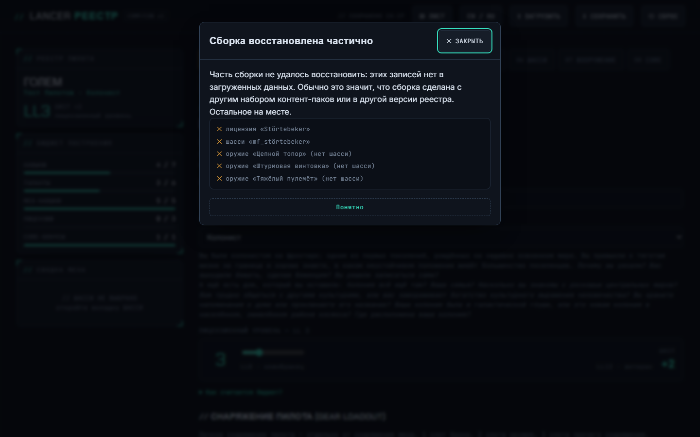
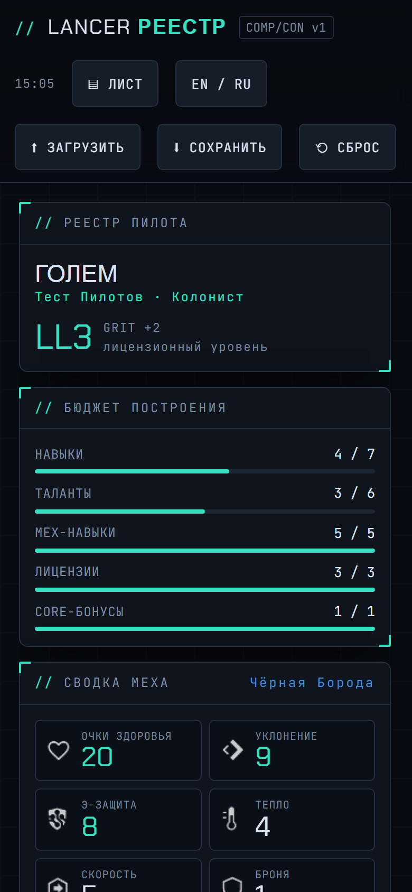
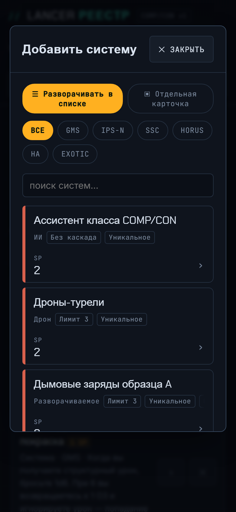
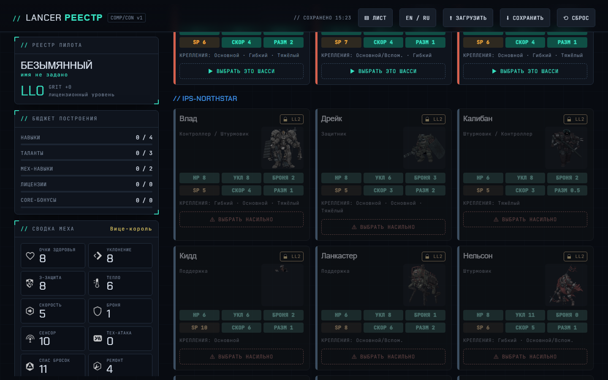
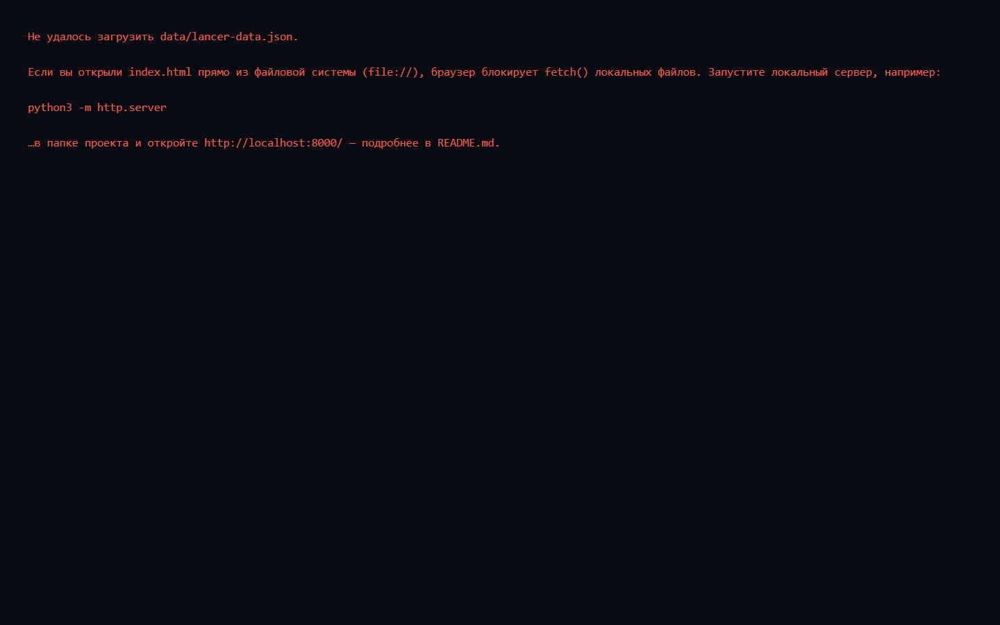
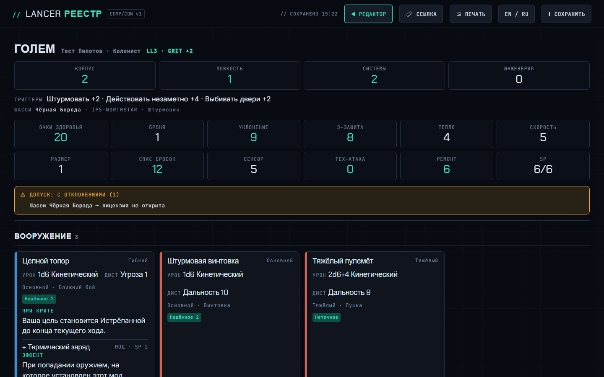
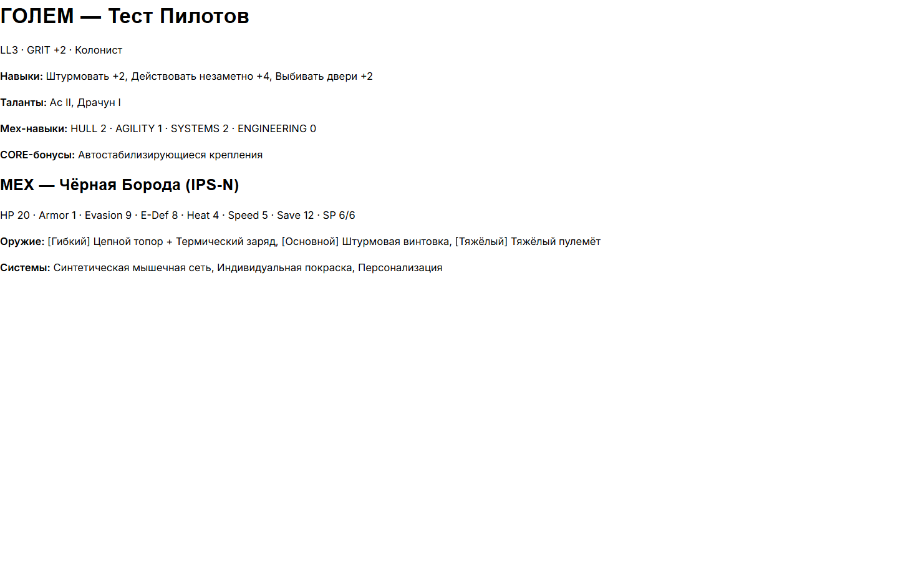
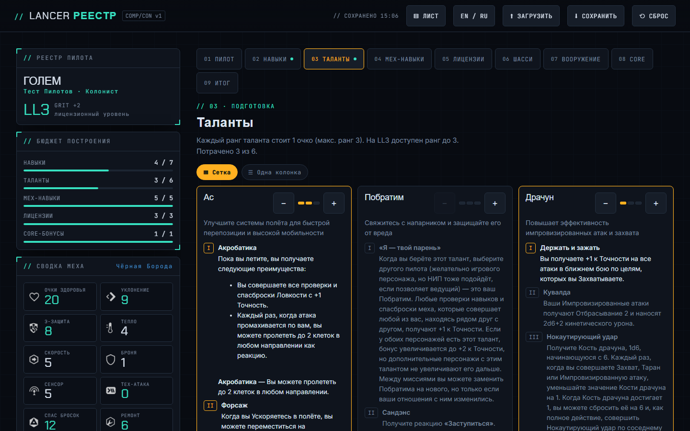
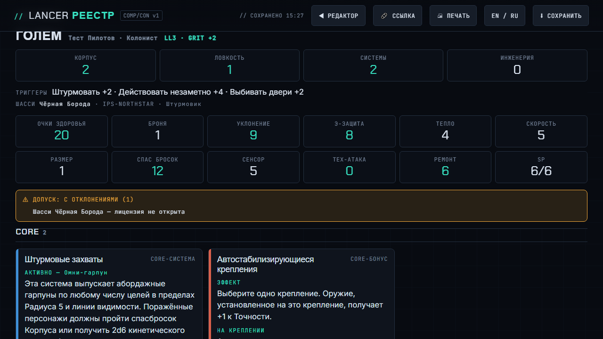
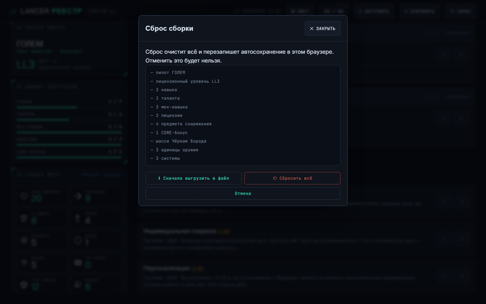

# UI/UX-аудит LANCER // РЕЕСТР

> **Метод: dual-agent.** A — дизайн-ревью, B — детектор с проверкой в
> браузере. Это два изолированных субагента: A не видел ни детектора, ни
> предыдущего отчёта. Их результаты сведены здесь, и каждую находку, которой
> не было в первом прогоне, я перед включением проверил сам.
>
> Дата: 2026-10-14 · Цель: `index.html` (9 вкладок, режим листа, печать в
> обоих режимах, модальные окна, ошибки загрузки) · Ширины 1440×900,
> 1280×720, 720×450 (≈200% масштаб), 390×844 · Этап 2 `PLAN.md`. Только
> находки, код не менялся.
>
> Первый прогон этого же дня шёл в одном контексте (26/40). Сравнение — в
> разделе «Что изменилось относительно первого прогона».

## Сводка

| | Оценка | Уровень |
|---|---|---|
| Эвристики Нильсена (A) | **25 / 40** (62.5%) | Приемлемо |
| Техническое здоровье | **13 / 20** | Приемлемо |

**Найдено:** 2 × P0 · 4 × P1 · 11 × P2 · 9 × P3.

**Главное:**

1. **[P0] Сбой загрузки одного дополнения безвозвратно уничтожает
   сохранённую сборку.** Шасси из недогрузившегося пакета выбрасывается,
   оружие уходит вслед за ним с пометкой «нет шасси», а автосохранение тут
   же перезаписывается. *Проверено.*
2. **[P0] С клавиатуры нельзя установить ни оружие, ни систему, ни
   снаряжение:** строки окон выбора — `div` без фокуса.
3. **[P1] Телефон: редактор — это HUD, а не вкладки.** Липкая шапка 173 px,
   HUD около 1100 px, вкладки начинаются на 1136 px. После нажатия на
   вкладку страница прыгает наверх.
4. **[P1] Карточки шасси и лицензий доступны только мышью.** После выбора
   шасси по Enter фокус уходит на `<body>`.
5. **[P1] Ошибка загрузки данных показывает игроку инструкцию для
   разработчика** (`python3 -m http.server`) и не даёт повторить попытку.

**Что дальше:** P0-1 — самая дешёвая и самая важная правка. Её стоит
сделать до этапа 6, как баг с битой ссылкой. Остальное — по порядку из
раздела «Порядок исправления».

## Вердикт по специфичности дизайна

**Пройдено** (A и B согласны). Интерфейс сделан под этот продукт:
- моноширинная учётная метка над каждым числом;
- цветной рельс производителя на карточке;
- разделитель «ЛИЦЕНЗИЯ НЕ ОТКРЫТА» в окне выбора;
- штамп «ДОПУСК: С ОТКЛОНЕНИЯМИ (1)» с поимённым списком нарушений;
- «ДОСТУП РАЗРЕШЁН ▸» на экране загрузки.

Всё это бюрократия Союза из мира Lancer, а не абстрактная фантастика. С
жанром совпадают только тёмный фон и бирюзовый акцент: это общий язык
конструкторов для настольных ролевых игр, и плашка `COMP/CON v1` отсылает к
официальному инструменту. Продукт отличается композицией и словарём, а не
палитрой.

**Детектор (B):** 79 срабатываний при сканировании файла, 44–211 на экран в
браузере. Предупреждения «типичный AI-интерфейс» (`side-tab`,
`ai-color-palette`, `codex-grid-background`) ложные: это уголки-скобки,
полоса типа действия, бирюзовый системный цвет и фоновая сетка, и все они
описаны в `DESIGN.md`.

## Эвристики Нильсена (оценка A)

| # | Эвристика | Оценка | Главная проблема |
|---|---|---|---|
| 1 | Видимость состояния | 3 | Бюджеты в HUD, точки на вкладках, «СОХРАНЕНО 15:22» — отлично. Но **легальность лицензий в редакторе не видна**: `buildViolations()` вызывается только в листе. HUD показывает «ЛИЦЕНЗИИ 3/3» полной зелёной полосой, хотя шасси не открыто. Окно выбора не показывает остаток SP |
| 2 | Язык пользователя | 3 | Перевод правил сильный. Протечки: «Чёрная Борода» / «Блэкберд» / `Blackbeard` на одном экране, «ТИП Striker», HP/Armor/Evasion в печати, «ВЫБРАТЬ НАСИЛЬНО» и «Установить всё равно» для одного действия, сырые id в диалоге восстановления |
| 3 | Контроль и свобода | 2 | Esc закрывает окна, сброс предлагает сначала выгрузить сборку. Но заблокированное шасси выбирается одним Enter без подтверждения, а частичное восстановление молча перезаписывает сохранение без возможности вернуть его |
| 4 | Единообразие | 2 | Две поверхности «лист» с разной печатью. Два глагола для одного действия. Эмодзи 🎯 💥 в карточке CORE вопреки правилу `DESIGN.md`. Залитые плашки статов на карточках шасси. Три формы степпера (число, 3 точки, 6 точек) |
| 5 | Предотвращение ошибок | 2 | Диалог сброса образцовый. Но шасси без лицензии ставится без вопроса, система за 2 SP встаёт при остатке 0, а сбой загрузки дополнения уничтожает сборку |
| 6 | Узнавание вместо запоминания | 3 | HUD рядом, глоссарий статов и тегов. Но «что открывает лицензия» спрятано за кликом, а бюджет SP в окне выбора закрыт затемнением |
| 7 | Гибкость и эффективность | 2 | Стрелки и Home/End на вкладках, поиск, фильтры, два вида окна выбора, ссылка на сборку. Но строки окон выбора недоступны с клавиатуры, нет быстрых действий |
| 8 | Эстетика и минимализм | 3 | Система цельная, плотность намеренная. Шум: дублирующийся текст эффектов, пустые квадраты вместо портретов, липкое досье в листе на половину экрана |
| 9 | Восстановление после ошибок | 2 | Отчёт о потерях честный, но с сырыми id, неверной причиной («другой набор паков» вместо сбоя сети) и уже сохранённой потерей. Фатальная ошибка — инструкция для разработчика без «Повторить» |
| 10 | Справка | 3 | Вводный абзац в каждой вкладке, «Как считается бюджет?», подсказки с клавиатуры и тапа. Нет пути «с чего начать» при первом визите |
| | **Итого** | **25 / 40** | **Приемлемо** |

## Техническое здоровье

| # | Измерение | Оценка | Главная находка |
|---|---|---|---|
| 1 | Доступность | 2 | P0-2 (окна выбора без клавиатуры), карточки-`div`, поля без подписей. Вкладки, модальные окна и подсказки сделаны хорошо |
| 2 | Производительность | 3 | Статичный сайт, свои шрифты, предзагрузка данных. Списки до 167 строк рендерятся целиком, пока без проблем |
| 3 | Адаптивность | 2 | Переполнения нет нигде, окно выбора работает на 720×450. Но мобильная архитектура (HUD перед вкладками, прыжок наверх, шапка 173 px) ломает работу |
| 4 | Темизация | 3 | Токены на `:root`, `DESIGN.md` актуален. Дрейф: дробные кегли, радиусы 5/7/9 px, 2 недокументированных цвета |
| 5 | Целостность реализации | 3 | Система цельная. «Слоп»-срабатывания ложные, остальное — мелкий дрейф |
| | **Итого** | **13 / 20** | **Приемлемо** |

## Находки

### P0 — блокирует задачу или теряет данные

#### P0-1. Сбой загрузки дополнения уничтожает сохранённую сборку

- **Где:** `soft()` в `loadBaseData` (`index.html:~1200`) превращает ошибку
  сети на дополнении в `null`. Затем `applyBuildState` (`:1752`) выбрасывает
  отсутствующие записи, и первый `render()` автосохраняет результат.
- **Проверено:** сборка на шасси Störtebeker из Dustgrave, файл дополнения
  отдаёт 404. Через секунду в `lancer_build` записаны `frameId: null` и
  пустые крепления. После того как дополнение снова доступно, шасси не
  возвращается. Каскадом пропадает и оружие из базовой книги («нет шасси»).
  
- **Влияние:** телефон на мобильной сети — равноправный сценарий, и
  кратковременный сбой там обычное дело. Игрок теряет сборку молча:
  диалог говорит «Остальное на месте» и называет неверную причину.
- **Исправление:**
  - если хоть один источник не загрузился, не перезаписывать
    `lancer_build`, пока пользователь сам не изменит сборку (по образцу
    исправленного бага с `?s=`); ещё надёжнее — хранить сырое исходное
    состояние рядом;
  - различать «дополнение не загрузилось» (плашка «Пакет Dustgrave не
    загружен — сборка не тронута · Повторить») и «такой записи нет в
    данных»;
  - не сносить оружие из-за отсутствия шасси;
  - в списке потерь показывать имена, а не id.
- **Команда:** `/impeccable harden`. Сразу добавить регрессионный тест в
  `persistence.spec.mjs`.

#### P0-2. Окна выбора оружия, систем и снаряжения недоступны с клавиатуры

- **Где:** `index.html:3149` (`weaponPickRow`, `data-w`), `:3164` (системы,
  `data-s`), `:3542` (снаряжение, `data-g`) — `<div class="listrow
  clickable">` только с `onclick`.
- **Проверено (A, B и первый прогон):** Tab ходит по кругу: вид, 7 чипов,
  поиск, «Закрыть» — и ни разу не попадает в список из 157 строк. У строк
  `tabIndex = -1`, роли нет.
- **Влияние:** пользователь клавиатуры или скринридера не может собрать мех.
- **Стандарт:** WCAG 2.1.1 (A), 4.1.2.
- **Исправление:** строку сделать `<button aria-expanded>`. Стрелки ↑/↓ из
  поиска переводят фокус в список.
- **Команда:** `/impeccable harden`.

### P1 — серьёзно мешает или нарушает WCAG AA

#### P1-1. Телефон: редактор — это HUD, а не вкладки

- **Где:** `activate()` `index.html:2246` (`scrollTo({top:0})`); `.hud`
  статичен на ≤1020 px (`:424`); липкая шапка с 5 кнопками в 2 ряда.
- **Проверено:**
  - шапка 173 px (20% экрана 844 px), HUD около 1100 px;
  - вкладки начинаются на 1136 px и стоят в 4 ряда;
  - после нажатия на вкладку `scrollY = 0`, а её содержимое на 1348 px;
  - при первом визите на экране нет ни одного поля ввода;
  - окно выбора систем показывает 2,5 строки на экран.

  
  
- **Влияние:** в `PRODUCT.md` записано, что узкий экран — полноценный режим.
  Сейчас каждая смена вкладки на телефоне стоит полутора экранов прокрутки.
- **Исправление:**
  - на ≤1020 px свернуть HUD в одну липкую строку бюджета («SP 6/6 · ЛИЦ
    3/3 · …»), которая раскрывается по нажатию;
  - вкладки поставить сразу под шапкой или внизу экрана, в зоне большого
    пальца;
  - прокручивать к `#tab`, а не к верху страницы;
  - шапку сжать в один ряд, редкие ЗАГРУЗИТЬ и СБРОС убрать в меню «⋯».
- **Команда:** `/impeccable adapt` → `/impeccable layout`.

#### P1-2. Карточки шасси и лицензий доступны только мышью, фокус теряется

- **Где:** `:2644` (`data-openlic`), `:2792` (`data-frame`), `.ei[data-vieww]`,
  `[data-viewmod]`, `.info[data-views]`, `:2329` (`data-viewpg`).
- **Проверено:** 52 карточки на вкладке лицензий, 55 на вкладке шасси. После
  выбора шасси по Enter фокус падает на `<body>`, страница уезжает, и Tab
  начинается заново с тулбара. 
- **Влияние:** что открывает каждый ранг лицензии и характеристики шасси
  до выбора — только мышью.
- **Стандарт:** WCAG 2.1.1, 2.4.3.
- **Исправление:** имя карточки сделать кнопкой. После `render()`
  возвращать фокус на эквивалентный элемент, например «✓ ВЫБРАНО».
- **Команда:** `/impeccable harden`.

#### P1-3. Поля формы без подписей

- **Где:** `:2278` `#f-name`, `:2280` `#f-call`, `:2283` `#f-bg`, `:2289`
  `#f-ll`, поля поиска `:3457`, `:3536`, `:3796`.
- **Проверено:** `<label>` без `for`, скринридер читает «напр. RONIN».
  Подпись слайдера LL не привязана.
- **Стандарт:** WCAG 1.3.1, 3.3.2, 4.1.2.
- **Исправление:** `<label for>`; `aria-label` у поиска; `aria-valuetext`
  у слайдера.
- **Команда:** `/impeccable harden`.

#### P1-4. Ошибка загрузки данных разговаривает с разработчиком

- **Где:** `:1231`.
- **Проверено:** при 404 на `data/lancer-data.json` — красный моноширинный
  текст про `file://` и `python3`, без шапки и без «Повторить».
  
- **Исправление:** для `location.protocol === "file:"` оставить текст для
  разработчика. Иначе — «Не удалось загрузить данные реестра · Повторить»
  и напоминание, что сохранённая сборка цела (после исправления P0-1).
- **Команда:** `/impeccable harden` + `/impeccable clarify`.

### P2 — мешает, есть обходной путь

| # | Проблема | Где / доказательство | Исправление | Команда |
|---|---|---|---|---|
| P2-1 | **Легальность видна только в листе.** «ЛИЦЕНЗИИ 3/3» показывается зелёным при незакрытом шасси. «⚠ ВЫБРАТЬ НАСИЛЬНО» срабатывает одним кликом без объяснения. Окно выбора не показывает остаток SP. Пустая сборка получает «✓ ДОПУСК ПОДТВЕРЖДЁН» (*проверено*). Нарушение принципа 3 из `PRODUCT.md`: вердикт приходит сюрпризом в конце  | `buildViolations()` только в листе (`:4200`, `:4391`) | Строка «ДОПУСК: 1 ОТКЛОНЕНИЕ ▸» в HUD; метка «🔒 лицензия не открыта» на выбранном шасси; «Осталось SP: 0» в шапке окна выбора и «перебор +2 SP» на строках; нейтральный штамп «СБОРКА НЕ НАЧАТА» | `/impeccable clarify` |
| P2-2 | **CORE-бонус до LL3 не помечается**: `cap>0 &&` отключает проверку при `cap = 0` и в табе, и в «ДОПУСКЕ» | `:2213`, `:4207` | Проверять `cores.length > cap` всегда | `/impeccable harden` |
| P2-3 | **Два «листа» и две печати.** Вкладка ИТОГ «Лист персонажа… распечатайте» дублирует режим ЛИСТ, а Ctrl+P из редактора печатает `#print-sheet`: голые абзацы с HP/Armor/HULL без эффектов  | `buildPrintSheet` `:4599`, `renderSummary` `:3836` | ИТОГ сделать переходом в лист; печать из редактора — тот же бланк | `/impeccable distill` |
| P2-4 | **Стена талантов:** 40 раскрытых карточек, 18 086 px на десктопе и 37 661 px на телефоне, без поиска и фильтра «взятые» . *В первом прогоне P1; A этот экран не выделил и счёл плотность намеренной — поэтому P2* | вкладка ТАЛАНТЫ | Свёрнутый вид по умолчанию, поиск, «Взятые / Все» | `/impeccable distill` |
| P2-5 | **Протечки перевода:** «ТИП Striker» (`mechtype` без `tr()`); Armor/Weapon и HP ARMOR EVASION у снаряжения; HULL/AGILITY и HP/Armor в печати; «Чёрная Борода» / «Блэкберд»; сырые id и «Störtebeker» в диалоге потерь | `:3853`, `:4602–4609`, `locales/ru/frames.json` | `tr()` + ключи в `enums.json`; глоссарий (этап 4) | `/impeccable clarify` |
| P2-6 | **Дублирующийся текст:** действие склеено с эффектом («Пластырь», «Стимуляторы», «Ас»); CORE-актив дважды во вкладке ШАССИ и в ИТОГЕ; эффект COMP/CON-ассистента дважды в раскрытой строке окна выбора | `tools/normalize_pack.py`, `renderSummary` | Не выводить действие, если его текст совпадает с эффектом | `/impeccable distill` |
| P2-7 | **Липкое досье в листе** занимает 47% высоты на 1440×900 и около 57% на 1280×720, под карточки остаётся около 250 px. На телефоне лист длиной 6599 px без перехода к разделам  | режим ЛИСТ | Досье не липкое (или сжимается до одной строки при прокрутке); оглавление разделов на телефоне | `/impeccable layout` |
| P2-8 | **Десктоп:** на ≤900 px HUD уходит во внутреннюю прокрутку (928 px в 804 px), полоса SP не видна. На 1440 px вкладки переносятся в 2 ряда | `.hud` `:422`, `.tabs` `:533` | Ужать HUD; вкладки в один ряд на ≥1280 px | `/impeccable layout` |
| P2-9 | **Неединообразие окон выбора:** окно оружия закрывается после установки, окно систем — нет; «1 / 2 · заполнено» на гибком креплении; «насильно» / «всё равно» | `openWeaponPicker` / `openSystemPicker` | Одно правило, один глагол, честный счётчик | `/impeccable polish` |
| P2-10 | **Лицензии:** 60 одинаковых карточек с повтором «ШАССИ открывается на ранге 2 · открыто предметов: 0» и пустыми квадратами вместо портретов (на ШАССИ — «NO IMAGE DATA») | вкладка ЛИЦЕНЗИИ | Повтор вынести в легенду; без картинки не рисовать слот; поиск; взятые наверх | `/impeccable distill` |
| P2-11 | **Контраст границ:** `--line` 1.38:1, `--line-bright` 1.97:1 на `--panel` (нужно ≥ 3:1, WCAG 1.4.11); `--faint` на `--panel-3` 4.17:1 | токены `:root` | Отдельный токен границы для интерактивных элементов | `/impeccable colorize` |

### P3 — шлифовка

- **P3-1. Мелкий текст.**
  - B в браузере: 169 подписей 10 px в окне выбора систем (`.rowstat .k`,
    `:722`), 12 подписей статов в HUD (`.stattile .k`), мета-строка оружия
    11.5 px (`:789`).
  - `DESIGN.md` прямо разрешает 10 px для меток, так что это **решение,
    которое нужно пересмотреть**, а не дрейф. Для игрока за столом с
    телефона это мелко.
  - → `/impeccable typeset`
- **P3-2. Мобильная шапка и тач.** Шапка 173 px липкая, все действия
  наверху, вне зоны пальца. Подсказки статов 26×26 px. «+ УСТАНОВИТЬ МОД» и
  «+ ДОБАВИТЬ СИСТЕМУ» высотой 37 px. → `/impeccable adapt`
- **P3-3. Двусмысленные подписи.**
  - «⬇ СОХРАНИТЬ» (выгрузка файла) рядом с «// СОХРАНЕНО» (автосохранение).
  - Кнопка языка «EN / RU»: непонятно, это текущее состояние или цель.
  - На телефоне без префикса остаётся голое «15:05».
  - → `/impeccable clarify`
- **P3-4. Структура.** В редакторе нет `<h1>` и ссылки «к содержимому».
  Заголовки разделов (`// КРЕПЛЕНИЯ ОРУЖИЯ`) визуально крупнее `h2` вкладки.
  → `/impeccable harden`
- **P3-5. Повторы в HUD:** плитка «ОЧКИ СИСТЕМЫ 6» и строка «СИСТ. ОЧКИ
  (SP) 6/6». → `/impeccable distill`
- **P3-6. Нарушения собственного `DESIGN.md`:** эмодзи 🎯 💥 в карточке
  CORE-актива; залитые плашки статов на карточках шасси; inline
  `font-family: Arial` в `buildPrintSheet` (`:4602`, `:4608`). →
  `/impeccable polish`
- **P3-7. Дрейф дизайн-системы (B, проверено по `DESIGN.md`):**
  - дробные кегли 9.5/10.5/13.5/14/14.5/15/18.5/19.5 px;
  - радиусы 5/7/9 px вне шкалы 3/4/6/8/10/20;
  - цвета `#ffcaa0` и `#a9c9ff` (`.tag.dmg` и `.tag.rng`, `:625–626`) нигде
    не описаны;
  - `#8b7fe8` и `#e87f9e` описаны в прозе, но их нет в токенах;
  - строка подсказки на вкладке «Пилот» длиной около 153 символов;
  - анимация `width` у полосы бюджета (`:453`).
  - → `/impeccable extract`
- **P3-8. Тема и цифры:** нет `color-scheme: dark`, `<meta
  name="theme-color">`, `tabular-nums`. → `/impeccable polish`
- **P3-9. Нет favicon** (404 в консоли).

## Персоны

**Сэм (только клавиатура и скринридер):**
- не может поставить ни одну систему, оружие или мод (P0-2);
- после выбора шасси фокус уходит на `body` (P1-2);
- «⚠ ВЫБРАТЬ НАСИЛЬНО» срабатывает одним Enter;
- фокус на полях виден (рамка и кольцо 3 px), это в порядке.

**Кейси (телефон одной рукой):**
- шапка 173 px, вкладки только после HUD, тап по вкладке уводит наверх;
- окно выбора показывает 2,5 строки на экран;
- цели 26 и 37 px;
- все действия наверху (P1-1, P3-2).

**Райли (стресс-тестер):**
- 404 на дополнении ведёт к безвозвратной потере шасси и трёх единиц
  базового оружия (P0-1);
- пустая сборка получает «ДОПУСК ПОДТВЕРЖДЁН»;
- сырые id в диалоге;
- ошибка загрузки для разработчика.

**Игрок за столом** (из `PRODUCT.md`):
- в листе досье занимает половину экрана ноутбука, а урон оружия
  приходится искать (P2-7);
- на телефоне лист 6599 px без перехода к разделам.

**Ведущий (проверка легальности):**
- в редакторе чужой сборки нарушение не видно нигде (P2-1);
- CORE-бонус до LL3 не ловится вовсе (P2-2);
- плюс: переключатель RU/EN для сверки с оригиналом работает и сохраняет
  русский интерфейс.

**Новый русскоязычный игрок:**
- одно шасси под тремя именами;
- сокращения HP / УКЛ / РАЗМ без расшифровки;
- «выбрать насильно» без объяснения последствий;
- флейвор происхождения набран курсивным моноширинным 13 px — это самый
  длинный абзац в интерфейсе.

## Когнитивная нагрузка

Провалено 3 из 8 пунктов (A) — нагрузка **умеренная**:

- **один фокус (телефон):** HUD около 1100 px между шапкой и содержимым;
- **минимум вариантов:**
  - 9 вкладок;
  - 6 кнопок тулбара;
  - в окне выбора систем 2 + 7 чипов, поиск и 157 строк;
  - около 20 навыков;
  - десятки карточек лицензий и шасси;
- **рабочая память:** в окне выбора не видно остатка SP и свободных
  креплений, «что открывает ранг» прячется за кликом.

Группировка, раскрытие строки окна выбора и `<details>` бюджета сделаны
правильно.

**Эмоциональная дуга:**
- **пик** — вкладка ШАССИ («это мой мех») и заполняющиеся полосы бюджета;
- **провалы:**
  - окно выбора на телефоне;
  - «ВЫБРАТЬ НАСИЛЬНО»;
  - **штамп «С ОТКЛОНЕНИЯМИ», который впервые появляется только в листе**,
    хотя в редакторе всё было зелёным (нарушение правила пика и конца);
- **конец смешанный:** лист прекрасен, но Ctrl+P из вкладки ИТОГ печатает
  заглушку.

## Что работает (сохранить)

- **Бюджеты в HUD и точки на вкладках.** Принцип «легальность видна на
  месте» для очков реализован буквально, точка не полагается только на
  цвет (`:2234–2238`).
- **Диалог сброса.** Перечисляет всё, что исчезнет, первым предлагает
  выгрузить файл, «Отмена» стоит последней. Подтверждение несёт информацию,
  а не ритуал. 
- **Режим листа и его печать.** Отдельная раскладка для чтения: досье,
  карточки с рельсом производителя, режимы оружия рядом, штамп допуска. На
  бумаге — две колонки и пунктир реза.
- **RU/EN меняет контент, но не интерфейс.** Английский оригинал работает
  как точка сверки (принцип 5).
- **Без переполнений и без ошибок консоли** на всех экранах. Окно выбора
  работает при 200% масштабе.

## Детектор (B)

**CLI** (`detect.mjs --json index.html`, exit 2, 79 срабатываний):

| Правило | Кол-во | Вердикт |
|---|---|---|
| `side-tab` | 3 | **Ложное.** Уголки-скобки (`:431–432`) и полоса типа действия (`:638`) описаны в `DESIGN.md` |
| `overused-font` | 16 | Справочно. Inter — заданный шрифт body. Inline Arial в печати → P3-6 |
| `layout-transition` | 1 | Верно, мелочь (`:453`) → P3-7 |
| `codex-grid-background` | 1 | Ложное: сетка — токен `grid-line` |
| `design-system-font-size` | 46 | Частично. Шкала в YAML `DESIGN.md` неполная, проза разрешает 10–13, 19–26, 33–37 px. Реальный дрейф — дробные кегли → P3-7. Детектор непоследователен: 11.5 px не помечает |
| `design-system-radius` | 8 | Верно для 5/7/9 px → P3-7 |
| `design-system-color` | 4 | `#ffcaa0` и `#a9c9ff` — дрейф; `#8b7fe8` и `#e87f9e` описаны в прозе, их нужно внести в токены → P3-7 |

**Браузер.** Внедрение прошло на 7 экранах, на десктопе и телефоне.
- **Найдено только в браузере:**
  - `undersized-ui-text` — 169 на окно выбора;
  - `tiny-text`;
  - `line-length` — 153 символа;
  - `wide-tracking`;
  - `gpt-thin-border-wide-shadow` — справочно;
  - `em-dash-overuse` — справочно, это текст контента.
- **Шум:** детектор сканирует скрытые элементы (`#boot`, закрытую модалку,
  скрытый HUD в листе). В листе 50 из 101 срабатывания приходятся на
  скрытое. `cramped-padding` на точке вкладки ложное.
- **Пропущено:** показ наложения человеку — в сессии нет видимого браузера.
  Live-сервер остановлен (`live-server.mjs stop`), файлы проекта не
  менялись.

## Web Interface Guidelines

```text
## index.html

index.html:3149 - <div onclick> pick row → <button> (P0-2); same :3164, :3542
index.html:2644 - <div onclick> license card → button (P1-2); same :2792, :2329
index.html:2278 - input lacks associated <label> (#f-name); same :2280, :2283, :2289
index.html:3457 - search input lacks label; same :3536, :3796
index.html:2278 - name/callsign: no autocomplete="off" / spellcheck=false
index.html:1090 - no skip link; no <h1> in editor
index.html:1728 - hardcoded hh:mm → Intl.DateTimeFormat
index.html:453  - transition: width → transform: scaleX
index.html:17   - no color-scheme: dark; no <meta name="theme-color">
index.html:-    - no tabular-nums on budget/stat numbers
index.html:-    - no overscroll-behavior: contain on modal body
index.html:-    - no touch-action: manipulation on +/− steppers
index.html:-    - frame/manufacturer names: no translate="no"
index.html:-    - active tab not in URL (no deep link)
```

Пройдено: `prefers-reduced-motion`, `:focus-visible`, нет `transition:
all`, нет запрета масштабирования, `aria-label` у иконочных кнопок, `alt`
и `loading="lazy"` у картинок, `aria-live` у статуса сохранения,
подтверждение опасных действий, `font-display: swap`.

## Что изменилось относительно первого прогона

| | Первый (single-context) | Этот (dual-agent) |
|---|---|---|
| Эвристики | 26/40 | 25/40 (A строже к контролю и предотвращению ошибок, мягче к эстетике) |
| P0 | 1 | **2**: добавлена потеря сборки при сбое загрузки дополнения |
| Новое от A | — | Легальность видна только в листе; пустая сборка «подтверждена»; выбор шасси без лицензии без подтверждения; потеря фокуса после выбора шасси; липкое досье в листе; шапка 173 px; дубли в окне выбора и в HUD; нарушения собственного `DESIGN.md` (эмодзи, заливки) |
| Новое от B | — | Реальный масштаб текста 10 px (169 в окне выбора); дрейф дизайн-системы отделён от решений, описанных в `DESIGN.md` |
| Понижено | Стена талантов P1 | P2: независимый ревьюер не счёл её главной проблемой |
| Совпало | | Клавиатура в окнах выбора, мобильная смена вкладок, ошибка загрузки для разработчика, две печати, протечки перевода, дубли текста, CORE до LL3 |

## Порядок исправления

Выбран пользователем 2026-10-14: «мобильная раскладка — первой, объём —
всё, ограничений нет». Новый P0-1 — потеря данных, поэтому он идёт вне
очереди, как баг с битой ссылкой.

0. **[P0] `/impeccable harden` — защита сохранения:** P0-1 + регрессионный
   тест.
1. **[P1] `/impeccable adapt` → `layout` — мобильная раскладка:** P1-1,
   P3-2, затем P2-8, P2-7.
2. **[P0/P1] `/impeccable harden` — клавиатура и семантика:** P0-2, P1-2,
   P1-3, P3-4 + тест «установить оружие с клавиатуры».
3. **[P1/P2] `/impeccable harden` + `clarify` — ошибки и легальность:**
   P1-4, P2-1, P2-2, P2-3.
4. **[P2] `/impeccable distill` — плотность:** P2-4, P2-10, P2-6, P3-5.
5. **[P2] `/impeccable clarify` — перевод и подписи:** P2-5, P3-3
   (вместе с этапами 4–5).
6. **[P2/P3] `/impeccable colorize` + `typeset`:** P2-11, P3-1, P3-8.
7. **[P3] `/impeccable extract` → `/impeccable polish`:** P2-9, P3-6,
   P3-7, P3-9.

## Вопросы на подумать (A)

1. Если штамп допуска — вердикт реестра, почему реестр выносит его только
   в конце? Что, если строка «ДОПУСК» живёт в HUD с первой минуты, как
   полоса бюджета?
2. Нужен ли телефону тот же редактор, что десктопу? Или своя раскладка:
   нижние вкладки, бюджет одной строкой, окно выбора на весь экран с SP в
   шапке?
3. Зачем одновременно вкладка ИТОГ и режим ЛИСТ? Что потеряется, если ИТОГ
   станет просто дверью в лист?
4. Должен ли неудачный `fetch` вообще иметь право переписывать сохранённую
   сборку?

## Попутно: устаревший контекст

`PRODUCT.md` расходится с кодом: там написано «сборка нигде не
персистится» (есть автосохранение), «`prefers-reduced-motion` не
обрабатывается» (обрабатывается), «тестов нет» (45 тестов). `DESIGN.md`:
шкала кеглей в YAML неполная относительно прозы (детектор из-за этого
даёт ложные срабатывания). Обновить через `/impeccable init` и
`/impeccable document`; в рамках аудита эти файлы не трогались.
